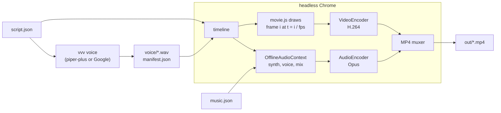

# VVV

VVV makes narrated videos in Chrome.
A movie is a storyboard (`script.json`), a score (`music.json`) and drawing code (`movie.js`).
Headless Chrome draws every frame from its time alone, encodes it with WebCodecs, and writes an MP4.

## Setup

Linux x64 and Node.js 24 or later.

```sh
npm install
node bin/vvv.js setup   # piper-plus, the Tsukuyomi-chan voice, Noto Sans JP, Playwright Chromium
```

The downloads go to `~/.cache/vvv`, or `$VVV_CACHE` when it is set (`$XDG_CACHE_HOME/vvv` when only that is set).
Chromium goes to Playwright's own cache.

## Make a movie

A movie is a directory that holds three files:

| File | What it says |
|---|---|
| `script.json` | The storyboard: the scenes in order, and the narration lines of each scene. |
| `music.json` | The score: chords, bass, drums and sound effects. Optional. |
| `movie.js` | The pictures: for each scene, a function that draws its frame at a given time. |

You never write when a scene starts.
Each scene lasts as long as its narration, which VVV measures from the generated voice.
The music and the drawings refer to scenes and lines by their ids, so they stay in step when the narration changes.

Here is a complete movie: a narrated "Hello", then a title that fades in with a bell.

`script.json`:

```json
{
  "scenes": [
    { "id": "hello", "lines": [{ "lang": "en", "text": "Hello from VVV." }] },
    { "id": "logo", "duration": 3, "transition": 0.5 }
  ]
}
```

`music.json`:

```json
{
  "bpm": 90,
  "tracks": [
    { "inst": "pad", "progression": ["C", "Am", "F", "G"] },
    { "inst": "bell", "unit": "seconds", "at": "logo + 0.5", "notes": [[0, 2, "C6"]] }
  ]
}
```

`movie.js`:

```js
import { defineMovie, text, seg, outCubic } from 'vvv';

const title = (g, s, words, size) =>
  text(g, words, { x: s.w / 2, y: s.h / 2, size, weight: 700, align: 'center', baseline: 'middle', color: '#ffffff' });

export default defineMovie({
  background: '#101624',
  scenes: {
    hello: { draw: (g, s) => title(g, s, 'Hello', 120) },
    logo: {
      draw(g, s) {
        g.globalAlpha = outCubic(seg(s.t, 0.2, 1.2));
        title(g, s, 'VVV', 200);
      },
    },
  },
});
```

Then run these commands on the directory, in order:

```sh
node bin/vvv.js validate my-movie   # check the three files, and say what to fix
node bin/vvv.js voice    my-movie   # speak the narration into my-movie/voice/
node bin/vvv.js preview  my-movie   # play the movie in your browser, at http://localhost:8573/
node bin/vvv.js check    my-movie   # draw every frame, and report errors and overflowing text
node bin/vvv.js render   my-movie   # write my-movie/out/my-movie.mp4
```

`node bin/vvv.js help` lists every command and option.
[`examples/wonderful-day/`](examples/wonderful-day/) is a longer movie: a cartoon with four characters, voiced by one voice at different pitches.

The MP4 holds H.264 video and Opus audio.
Chrome on Linux cannot encode AAC.
When scenes have chapter titles, the MP4 carries them as chapters, and `render` writes them into `out/` for web players and YouTube.

The references in [`skills/make-video/references/`](skills/make-video/references/) explain every field of the three files.
The schemas in [`schema/`](schema/) define the two JSON files.
Set a file's `"$schema"` to the schema's path on your disk, and your editor completes and checks the fields.

## Use it from Claude Code

The repository is a Claude Code plugin with one skill, `make-video`.
Install it from the marketplace this repository defines:

```
/plugin marketplace add ymmt2005/vvv
/plugin install vvv@vvv
```

To try a local checkout without installing it, start Claude Code with `claude --plugin-dir <path to this repository>`.
Then ask for a video, or run `/vvv:make-video`.

## Voice engines

- `piper-plus` (default) runs offline and speaks Japanese, English and four more languages in one voice.
- `google` uses Google Cloud Text-to-Speech with Chirp 3 HD voices, billed to a GCP project.

A per-language pronunciation dictionary in `script.json` fixes names and acronyms that an engine misreads.
See [voice.md](skills/make-video/references/voice.md).

## How it works

VVV never records a screen or plays anything in real time.
It computes each frame from its time alone, so Chrome draws the frames one by one, as fast as it can, and the same time always gives the same picture.
It computes the soundtrack ahead of time in the same way, and Chrome's own encoders turn both into an MP4.
Apart from Playwright, three.js and the voice engines, every part is VVV's own code: there is no ffmpeg, no audio library and no MP4 library.



**The voice sets the pace.**
`vvv voice` runs in Node before anything is drawn.
It speaks each narration line into a WAV file and records the clip's length in `voice/manifest.json`.
The timeline places every line and sizes every scene from those lengths and the `timing` gaps, so nobody writes timestamps by hand.
When a line changes, `vvv voice` speaks it again and the scenes move to fit.
It skips a line whose text and voice settings have not changed.

**Each frame is a function of time.**
`movie.js` draws on a 2D canvas for a given time `t`.
It keeps no state between frames, and it takes random numbers from a seeded generator.
That is why `frames` can draw any single frame, `check` can draw every frame without encoding, and `render` gets the same frames as both.
A three.js layer renders 3D scenes into the same canvas.
In headless Chrome it runs on SwiftShader, Chrome's software GPU.
VVV draws the subtitles and the default credits card from the timeline, so `movie.js` needs no code for them.

**The audio is rendered, not played.**
The soundtrack is one Web Audio graph in an `OfflineAudioContext`, which computes the whole track faster than real time.
The music comes from VVV's own synthesizer instruments, which play the score in `music.json`.
The graph mixes in the voice clips, lowers the music while someone speaks, adds reverb and a delay, and ends in a compressor.
`preview` plays this same buffer, so the preview sounds exactly like the MP4.

**Chrome encodes, and VVV writes the MP4.**
WebCodecs, Chrome's API to its media encoders, turns the canvas frames into H.264 and the audio buffer into Opus.
VVV's own muxer puts both streams into one MP4 file, with the chapters as a QuickTime chapter track.
It writes the file's index (the `moov` box) before the media, so a browser can start playing before the whole file arrives.
The page sends the finished file to the CLI, which saves it in `out/`.

**The CLI drives Chrome.**
The CLI starts an HTTP server on localhost, which serves the runtime, the movie directory and the fonts.
Chrome allows WebCodecs only on a secure origin, and localhost counts as one.
Playwright opens the player page in headless Chromium and calls the page's functions, such as `window.vvv.render`, directly.
`vvv preview` serves the same page to your own browser.

## Tests

```sh
npm test
```

Unit tests run in Node.
End-to-end tests render the fixture movies in `test/fixtures/` in headless Chrome, and decode the results with WebCodecs.

## Third-party parts

- [three.js](https://threejs.org/) 0.187.0, in `runtime/vendor/three` (MIT).
- [piper-plus](https://github.com/ayutaz/piper-plus) 2.1.0 for speech, downloaded by `setup`.
- The Tsukuyomi-chan zs-v1 voice model, downloaded by `setup`.
  Every video that uses it must show the credit `Piper Plus:つくよみちゃん`; VVV adds it to the credits card.
  Read the [model terms](https://huggingface.co/ayousanz/piper-plus-tsukuyomi-chan) before you publish a video.
- [Noto Sans JP](https://fonts.google.com/noto/specimen/Noto+Sans+JP) (SIL Open Font License), downloaded by `setup`.
- [Playwright](https://playwright.dev/) drives headless Chrome.
